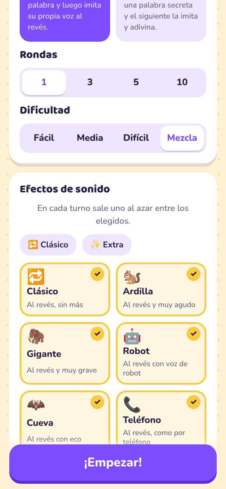
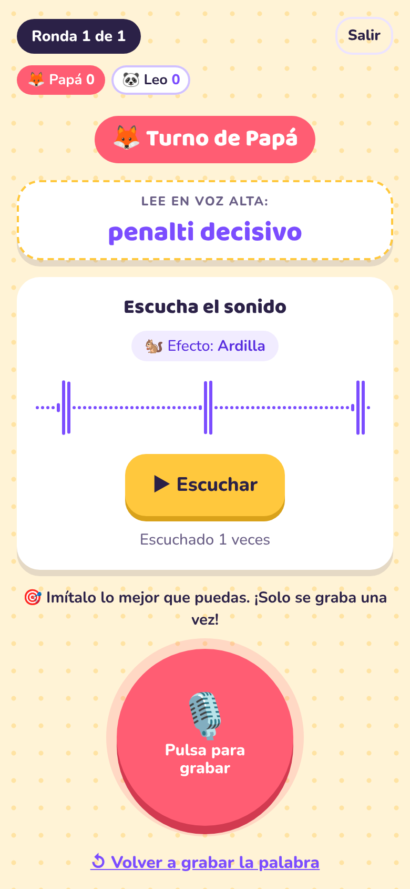
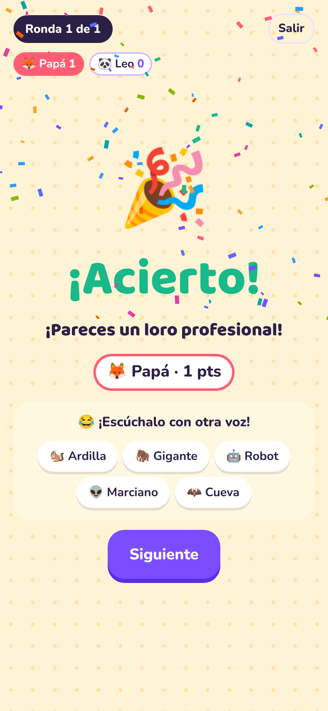
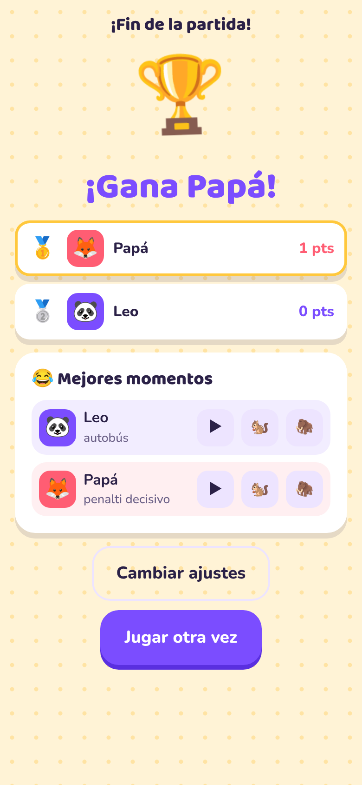

# 🎙️ Ecos al Revés

**¿Eres capaz de hablar al revés?**

Lee una palabra en voz alta. El móvil la reproduce **al revés**. Ahora imita ese sonido rarísimo… y la app le vuelve a dar la vuelta. ¿Suena como la palabra original? 🤣

Un juego de risas garantizadas para jugar en familia, con amigos o en fiestas. Solo necesitas **un móvil** que vais pasando de mano en mano.

▶️ **[¡Juega gratis ahora en el navegador!](https://jmerenciano.github.io/ecos-al-reves/)** · 📱 Android · 🍎 iOS *(próximamente)*

<p align="center">
  
  
  
  
</p>

## ✨ Por qué te va a gustar

- 👨‍👩‍👧‍👦 **De 1 a 10 jugadores** con un solo móvil
- 🎤 **Tres modos:** *Solo* (imita tu propia voz), *Reto* (adivina la palabra secreta de otro) y 🏆 *Competición* (todos imitan el mismo sonido y votáis quién se acerca más; una ronda por jugador)
- 🐿️ **8 efectos locos:** Ardilla, Gigante, Robot, Cueva, Teléfono, Puzle, Marciano y Clásico
- 😂 **Vuelve a escuchar cada imitación con voces graciosas** y repasa los **mejores momentos** al final de la partida
- 🌍 **7 idiomas:** español, inglés, catalán/valenciano, francés, portugués, italiano y alemán
- 📚 **Temarios:** deportes, casa, animales, comida, viajes… descarga más o crea los tuyos y compártelos
- 🔒 **Sin registro.** No guardamos tu voz: todo ocurre en tu móvil

## 🤝 ¡Ayúdanos a crecer!

¿Hablas otro idioma o se te ocurre un temario divertido? **Las contribuciones son bienvenidas:**

- 🌐 **Traduce el juego** a tu idioma (`www/js/i18n.js`)
- 📝 **Crea un temario** (un archivo JSON en `www/packs/<idioma>/`) y abre un Pull Request
- 🐛 **Avisa de errores** o propón ideas en *Issues*

⭐ **Si te ha hecho reír, ¡dale una estrella al repositorio!** Nos ayuda a que más familias lo descubran.

---

## Cómo se juega

1. Lees una palabra en voz alta.
2. La app la reproduce **al revés** (con un efecto al azar entre los que elijas).
3. Imitas ese sonido. Puedes escucharlo todas las veces que quieras, pero **solo se graba una vez**.
4. La app da la vuelta a tu imitación y los demás votan **Acierto** o **Fallo**. Después, ¡a escucharla con voz de ardilla! 🐿️

## Temarios

- **Incluidos** en la app (funcionan sin internet): Deportes, Casa, Animales, Comida, y Viajes y lugares, en los 7 idiomas.
- **Catálogo descargable**: la app lee `www/packs/catalog.json` desde este repositorio, así que para publicar un temario nuevo no hace falta actualizar la app:
  1. Crea `www/packs/<idioma>/<nombre>.json` (copia uno existente como plantilla).
  2. Ejecuta `npm run packs` para regenerar el catálogo.
  3. Haz commit y push.
- **Especiales** (`"premium": true`): Navidad 🎄, Halloween 🎃, Fútbol 🥅 y Trabalenguas 👅 en los 7 idiomas, más Profesiones y Música en español e inglés. En las apps se desbloquean viendo un vídeo con recompensa (o todos a la vez con «Quitar anuncios»). En la web se descargan gratis.
- **Propios**: desde *Gestionar temarios* puedes crearlos, exportarlos (compartir archivo o copiar texto) e importarlos.

Si un temario lleva `"builtin": true`, se incluye dentro de la app al ejecutar `npm run packs`.

## Publicidad (AdMob)

Los anuncios **solo aparecen en las apps de Android e iOS**. La web no tiene anuncios. Están pensados para no estropear la diversión:

| Anuncio | Cuándo |
|---|---|
| Pantalla completa (intersticial) | Entre turnos, cada 4 turnos como mucho y nunca dos con menos de 2,5 minutos de diferencia. Nunca mientras se graba o suena una voz. |
| Vídeo con recompensa | Solo si el jugador quiere desbloquear un temario *Especial*. |

Solo se piden anuncios aptos para todos los públicos (clasificación G). En Europa se muestra el formulario de consentimiento de Google, que se puede cambiar en *Opciones de anuncios*, y en iPhone se pide el permiso de seguimiento.

**Para activar los anuncios reales:**
1. Crea una cuenta en [AdMob](https://admob.google.com) y añade las apps de Android e iOS.
2. Crea para cada una un bloque **Intersticial** y otro **Bonificado (rewarded)**.
3. En **Privacidad y mensajes**, crea el mensaje de consentimiento RGPD.
4. Copia tus IDs en `www/js/config.js` (`ads.ids`) y cambia `useTestAds` a `false`.
5. Ejecuta `npm run sync` para aplicarlos a los proyectos nativos.

⚠️ Mientras pruebas, deja `useTestAds: true`. Si pulsas tus propios anuncios reales, AdMob puede cerrarte la cuenta.

### Compra «Quitar anuncios»

Pago único (producto **no consumible**) que quita los anuncios para siempre y desbloquea todos los temarios Especiales. No necesita servidor propio: lo gestiona el plugin `cordova-plugin-purchase` con Google Play y App Store, e incluye el botón **Restaurar compras** que exige Apple.

1. **Google Play Console** → tu app → *Monetizar → Productos → Productos integrados en la aplicación* → crea `remove_ads` y ponle precio (por ejemplo 2,99 €). Para que aparezca, la app tiene que estar subida al menos a la pista de *Pruebas internas*.
2. **App Store Connect** → tu app → *Compras dentro de la app* → crea un producto **No consumible** con el ID `remove_ads`. En Xcode, añade la capacidad **In-App Purchase** (*Signing & Capabilities → + Capability*).
3. Si quieres usar otro ID, cámbialo en `www/js/config.js` (`purchases.removeAdsId`).

La política de privacidad está en `www/privacy.html` (se publica en `…/ecos-al-reves/privacy.html`). Los textos de las fichas de las tiendas en los 7 idiomas están en [`docs/fichas-tiendas.md`](docs/fichas-tiendas.md).

## Probar en local

```bash
npm run serve
```

Abre http://localhost:8080. El micrófono solo funciona en `localhost`, en una página `https://` o dentro de la app.

## Web (GitHub Pages)

El workflow `.github/workflows/pages.yml` publica la carpeta `www/` en cada push a `main`. Actívalo una vez en **Settings → Pages → Source: GitHub Actions**. La web quedará en `https://<usuario>.github.io/ecos-al-reves/` y se puede instalar en el móvil desde el navegador (Añadir a pantalla de inicio).

## App Android

📘 **Guía completa para publicar en Google Play:** [`docs/google-play-paso-a-paso.md`](docs/google-play-paso-a-paso.md)

- **Versión final firmada para Google Play (.aab):** pestaña **Actions → Versión Google Play → Run workflow** (necesita los secretos de la llave de firma; ver la guía).


- **APK de prueba sin instalar nada**: pestaña **Actions → APK Android → Run workflow**, y descarga el APK cuando termine.
- **En tu ordenador** (necesita Android Studio):
  ```bash
  npm install
  npm run android:init
  npm run sync
  npm run android:open
  ```
  Para publicarla en Google Play necesitas una cuenta de desarrollador (pago único de 25 $) y generar un AAB firmado desde Android Studio.

## App iOS

Necesita un Mac con Xcode y, para publicar en la App Store, una cuenta de Apple Developer (99 $/año).

```bash
npm install
npm run ios:init
npm run sync
npm run ios:open
```

## Estructura

```
www/                 la app (HTML, CSS, JS): es lo que se publica y se empaqueta
  js/app.js          pantallas y lógica de la partida
  js/audio.js        micrófono, inversión y efectos de sonido
  js/i18n.js         textos en todos los idiomas
  js/packs.js        temarios: catálogo, descarga, importar y exportar
  js/config.js       catálogo online y configuración de anuncios
  js/ads.js          anuncios AdMob (solo en las apps)
  js/purchases.js    compra «Quitar anuncios»
  privacy.html       política de privacidad
  packs/             temarios en JSON + catalog.json
scripts/             generador del catálogo y configuración nativa (micrófono y AdMob)
docs/                capturas y textos para las tiendas
capacitor.config.json  configuración de las apps Android/iOS
```
